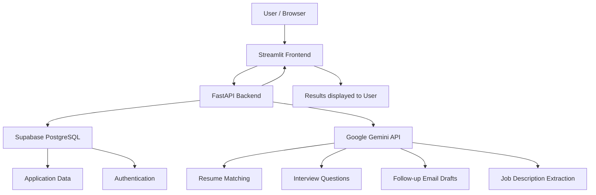

# 🚀 CareerTrack AI
### AI-Powered Career & Job Application Management System

<p align="center">
  
  
  
  
  
  
</p>

<p align="center">
  <b>Track Applications • Analyze Resumes • Prepare for Interviews • Manage Your Career</b>
</p>

<p align="center">
  <a href="https://careertrackerairesumematching.streamlit.app/">
    
  </a>
</p>

---

## 📌 Overview

**CareerTrack AI** is an AI-powered career management platform designed to help students, freshers, and job seekers organize their job applications and prepare for career opportunities.

Instead of managing applications through multiple spreadsheets, notes, and separate tools, CareerTrack AI brings important job search activities together in one centralized platform.

It combines application tracking, resume management, AI-powered resume matching, interview preparation, follow-up email generation, and career analytics to make the job search process more organized and efficient.

---

## 🎯 Problem Statement

Managing multiple job applications can become challenging, especially for students and freshers applying to different companies simultaneously.

Some common problems include:

- Keeping track of multiple job applications and their statuses.
- Remembering application dates and follow-up activities.
- Understanding whether a resume matches a job description.
- Identifying skills that need improvement.
- Preparing for interviews based on specific job roles.
- Writing professional follow-up emails.
- Understanding overall job application progress.

CareerTrack AI addresses these challenges by providing a centralized platform with AI-assisted career preparation and application management.

---

## 💡 What CareerTrack AI Does

CareerTrack AI helps users manage their job search through a simple workflow:

1. **Add Applications** – Save company names, job roles, application dates, and statuses.
2. **Manage Resumes** – Upload and organize resumes.
3. **Analyze Job Descriptions** – Extract important job information using AI.
4. **Match Resumes** – Compare resumes with job descriptions and identify matching skills.
5. **Prepare for Interviews** – Generate interview questions based on selected job roles.
6. **Draft Follow-up Emails** – Create professional email drafts using AI.
7. **Track Progress** – View application statistics and career analytics.

---

## ✨ Features

| Feature | Description |
|---|---|
| 📊 **Application Dashboard** | View application statistics, interviews, offers, and rejections. |
| 📝 **Job Application Management** | Add, edit, delete, and organize job applications. |
| 📄 **Resume Management** | Upload and manage resumes through the platform. |
| 🤖 **AI Job Description Extraction** | Extract company, role, skills, location, and experience from job descriptions. |
| 🎯 **AI Resume Matching** | Analyze resume and job description alignment with a match score and AI-generated summary. |
| 🧠 **Matching Skills Analysis** | Identify matching skills and skills that may need improvement. |
| 🎤 **Interview Preparation** | Generate Technical, Behavioral, Role-specific, and Company & Motivation questions. |
| 📧 **Follow-up Assistant** | Generate editable, personalized follow-up email drafts. |
| 📈 **Career Analytics** | Analyze application trends, interview rates, and offer rates. |
| 🔍 **Search & Filtering** | Filter applications by company, role, status, and date. |
| 📚 **Application History** | Maintain a history of application status changes. |

---

## 🧠 AI Integration

CareerTrack AI integrates **Google Gemini API** to provide intelligent career assistance.

### AI-Powered Capabilities

- **Job Description Extraction:** Extracts important information such as company, role, required skills, location, and experience.
- **Resume Matching:** Analyzes resume content against job requirements and generates a match score, summary, matching skills, and skills to review.
- **Interview Preparation:** Generates role-specific interview questions across different categories.
- **Follow-up Email Generation:** Creates professional follow-up email drafts based on application information.

> AI-generated outputs are intended to support career preparation. Resume match scores are estimates and do not guarantee interview selection or job offers.

---

## 🏗️ System Architecture

CareerTrack AI follows a frontend-backend architecture with separate database and AI integrations.



### Architecture Components

| Component | Purpose |
|---|---|
| **Streamlit** | Provides the interactive user interface. |
| **FastAPI** | Handles backend logic and REST API requests. |
| **Supabase** | Provides PostgreSQL database and authentication services. |
| **Google Gemini API** | Generates AI-powered analysis and career assistance. |
| **GitHub** | Stores and manages the project source code. |
| **Render** | Hosts the FastAPI backend. |
| **Streamlit Community Cloud** | Hosts the frontend application. |

### Application Workflow

1. The user interacts with the Streamlit frontend.
2. Streamlit sends API requests to FastAPI.
3. FastAPI processes the request and connects to the required services.
4. Supabase handles database operations when required.
5. Gemini generates AI responses when required.
6. FastAPI returns the response to Streamlit.
7. Streamlit displays the results to the user.

---

## 🛠️ Tech Stack

### Frontend
- Python
- Streamlit

### Backend
- Python
- FastAPI
- Uvicorn
- Pydantic
- REST APIs

### AI / Generative AI
- Google Gemini API

### Database & Authentication
- Supabase
- PostgreSQL
- SQLite (Demo Mode)

### Deployment & Version Control
- Streamlit Community Cloud
- Render
- GitHub

---

## 🌍 Real-World Applications

CareerTrack AI can be useful for:

- 🎓 Students managing internship and placement applications.
- 💼 Freshers tracking job opportunities across companies.
- 📄 Job seekers analyzing resume-to-job alignment.
- 🎤 Candidates preparing for role-specific interviews.
- 📈 Individuals monitoring their job search progress.
- 🗂️ Users organizing their career preparation activities.

---

## 🚀 Live Application

Try CareerTrack AI here:

### 👉 [Open CareerTrack AI](https://careertrackerairesumematching.streamlit.app/)

The application is deployed online with a Streamlit frontend and FastAPI backend.

---

## 📂 Repository Structure

```text
CareerTracker-AI/
│
├── backend/
│   ├── main.py
│   ├── ai_service.py
│   └── ...
│
├── frontend/
│   ├── app.py
│   └── ...
│
├── requirements.txt
├── README.md
└── ...
```

*The repository structure may evolve as additional features and improvements are introduced.*

---

## 🔐 Security & Configuration

CareerTrack AI uses environment variables and application secrets to manage sensitive configuration values.

- Gemini API keys are configured through environment variables.
- Supabase credentials are configured securely.
- Backend configuration is managed through Render environment variables.
- Frontend configuration is managed through Streamlit secrets.

**Never commit API keys, passwords, or private credentials to GitHub.**

---

## 🔮 Future Scope

Potential improvements for CareerTrack AI include:

- 📅 Application follow-up reminders.
- 📄 Downloadable application reports.
- 📊 Enhanced career analytics and visualizations.
- 🎯 Improved resume analysis and job matching.
- 🧠 Retrieval-Augmented Generation (RAG) for more context-aware career assistance.
- 📚 Personalized interview preparation based on resume and job requirements.
- 🔔 Application deadline notifications.

*These are possible future enhancements and are not currently claimed as implemented.*

---

## 🏁 Conclusion

CareerTrack AI combines job application tracking, resume analysis, interview preparation, follow-up email generation, and career analytics into one platform.

By bringing these activities together, it aims to help students and job seekers stay organized, understand job requirements, prepare more effectively, and manage their career opportunities with greater confidence.

---

## 👩‍💻 Developed By

**Sakshi Patil**

B.Tech – Electronics & Telecommunication Engineering

MIT Academy of Engineering, Alandi, Pune

### 🔗 Project Links

- 🌐 **Live Application:** [CareerTrack AI](https://careertrackerairesumematching.streamlit.app/)
- 💻 **GitHub Repository:** [CareerTracker-AI](https://github.com/Sakshi2004-29/CareerTracker-AI)

---

<p align="center">
  ⭐ If you find this project interesting, consider starring the repository!
</p>

<p align="center">
  <b>CareerTrack AI — Your Career, Organized.</b>
</p>
